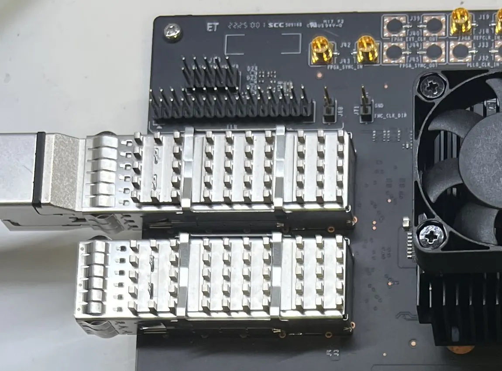
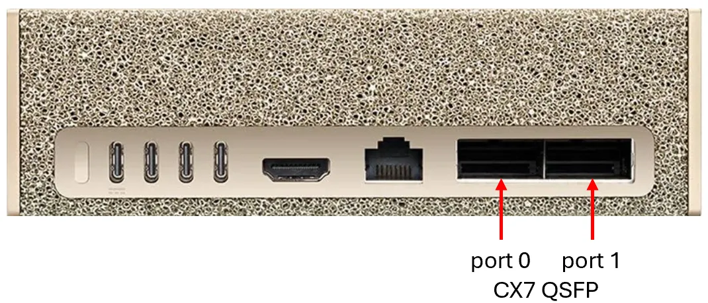
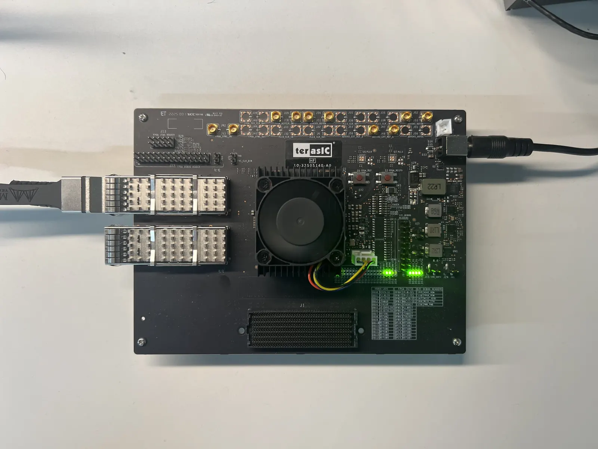
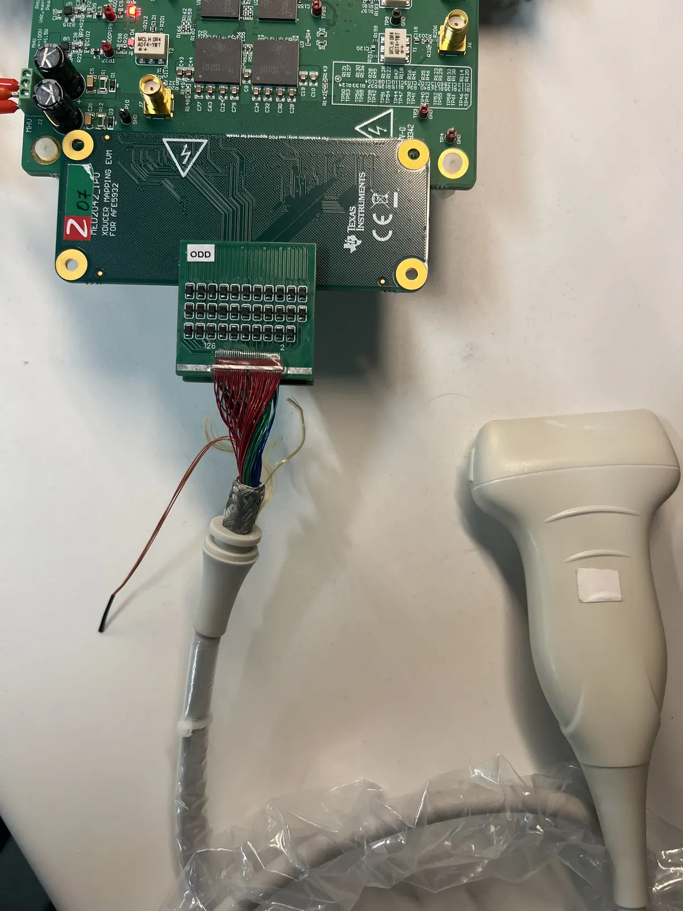
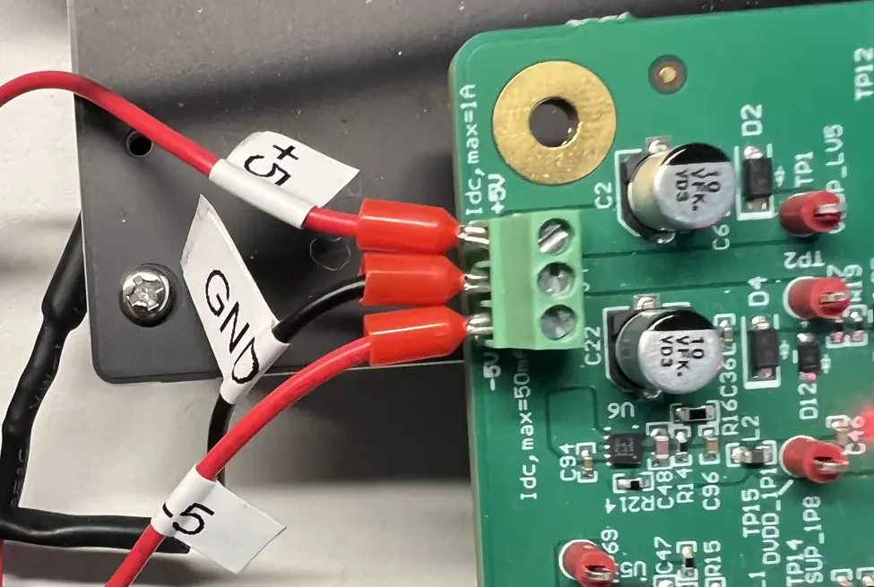
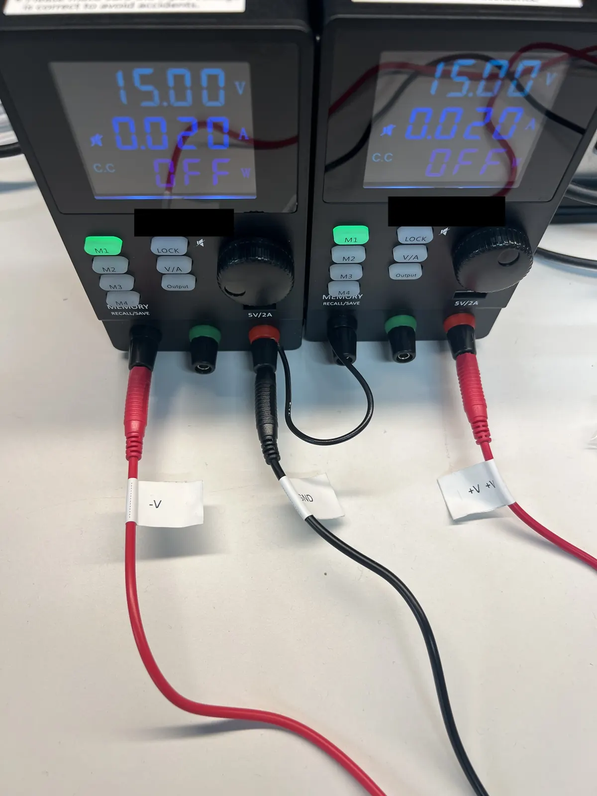
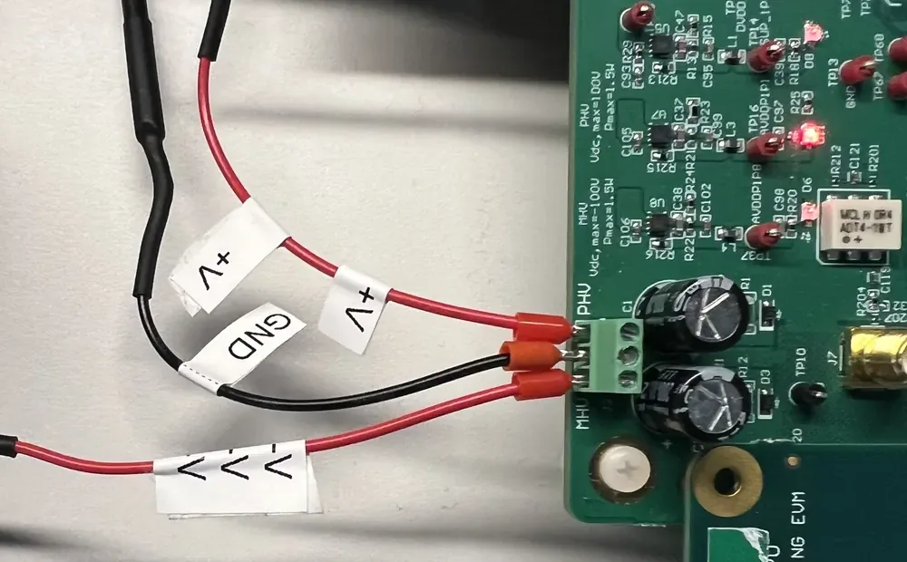
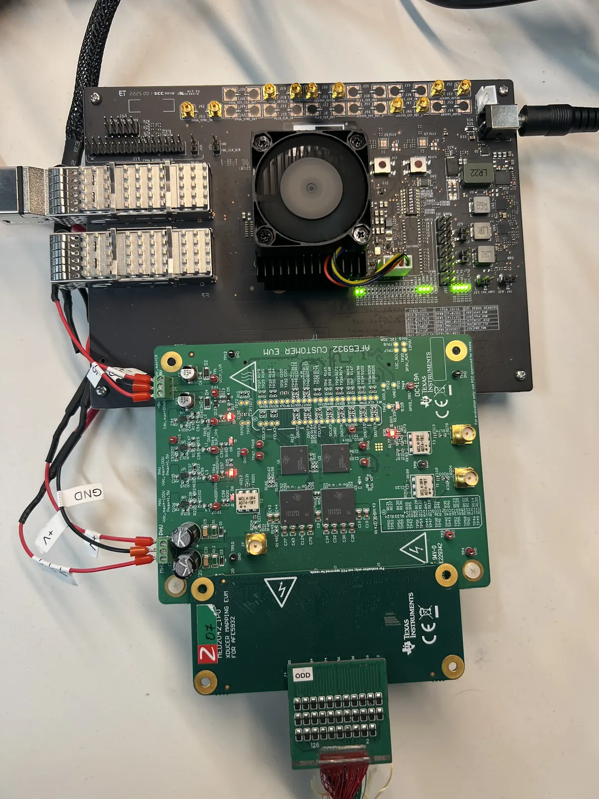
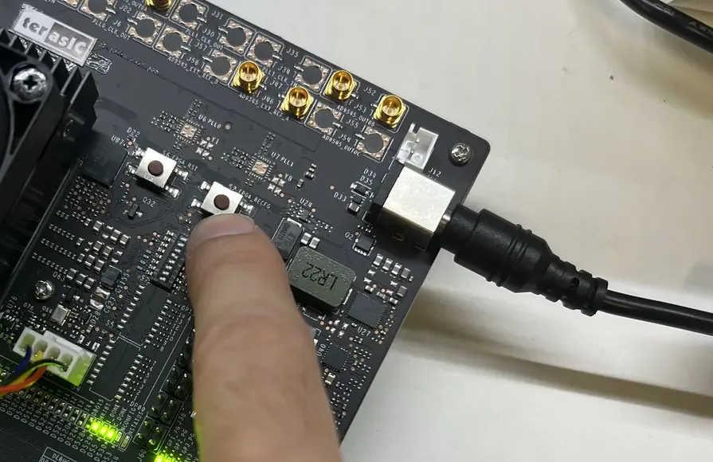
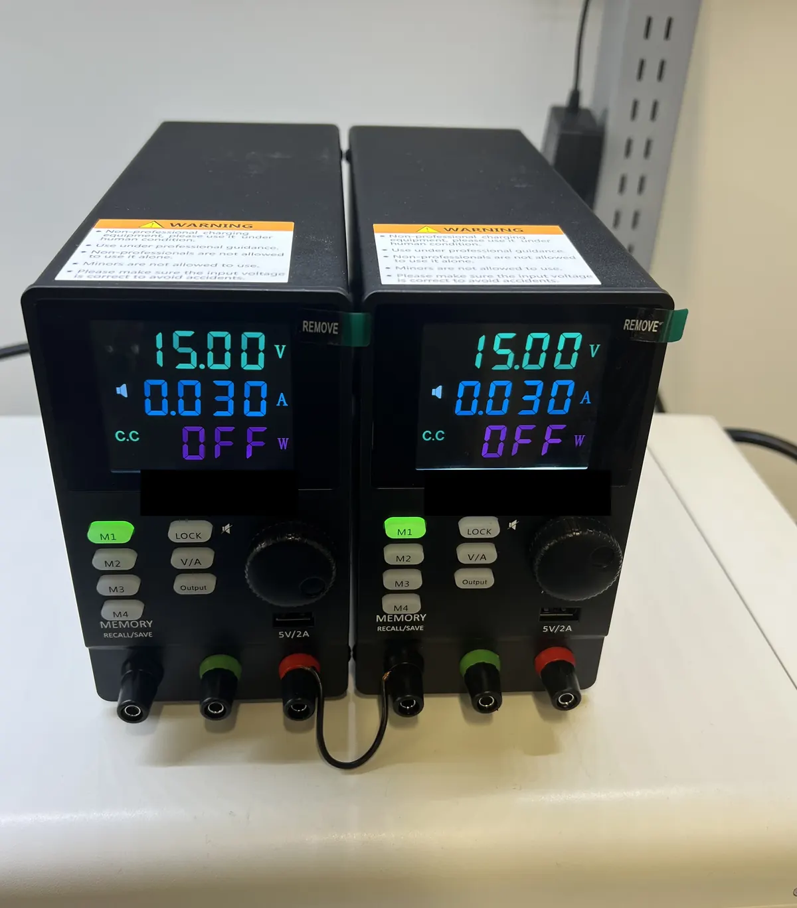

# Hardware setup

Holoscan Ultrasound Imaging hardware reference architecture.
Parts: [shopping list](hardware.md). Commands run from the project folder on the host.

Read all steps before beginning. When following NVIDIA's HSB host guide, stop at
the point identified in step 3 and return to this guide.

> [!WARNING]
> ⚠️ ATTENTION: OBSERVE PRECAUTIONS FOR HANDLING ELECTROSTATIC-DISCHARGE-SENSITIVE DEVICES.

## 1. Connect the HSB to the host

Keep all hardware unpowered. For initial bring-up, connect only:

- Terasic QSFP28 → host's board-facing RDMA NIC.
- Terasic 12 V input.
- Monitor, keyboard and mouse → host.

Do not connect the AFE5932EVM, probe or ultrasound power supplies yet.

<div align="center">
  
  <br>
  <span style="color: #8c959f;"><em>QSFP28 cable in the upper HSB port.</em></span>
</div>

<div align="center">
  
  <br>
  <span style="color: #8c959f;"><em>On DGX Spark, connect the HSB to ConnectX-7 QSFP port 0. <a href="https://docs.nvidia.com/holoscan/sensor-bridge/getting-started/hardware-setup">Source: NVIDIA HSB hardware setup</a>.</em></span>
</div>

## 2. Power the HSB

1. Confirm the AFE5932EVM and ultrasound supplies are disconnected.
2. Power the host.
3. Connect the HSB 12 V barrel plug.
4. Confirm the expected HSB LEDs.

Only the HSB is powered at this stage.

<div align="center">
  
  <br>
  <span style="color: #8c959f;"><em>HSB powered; AFE5932EVM remains disconnected and powered off.</em></span>
</div>

## 3. Prepare the host for HSB

Follow NVIDIA's [HSB 2.7 Host Setup](https://docs.nvidia.com/holoscan/sensor-bridge/2-7-latest/getting-started/host-setup):

1. Complete the common prerequisites, then the **DGX Spark** tab for a Spark host.
   For another host, select its matching instructions. Reboot where requested.
2. Continue through **Now, for all configurations**, including PTP and NGC login.
   Skip steps explicitly marked for other platforms.
3. **Stop after `docker login nvcr.io` reports `Login Succeeded`.** Do not follow
   **build and test the Holoscan Sensor Bridge container**. Return here for the
   connection checks, then step 4 (`./setup`).

`./setup` builds our container instead of the upstream demo; it does not configure
host drivers or networking.

```bash
# Identify the board-facing interface and RDMA link.
ip -br address
# Expect: the board-facing interface is UP.
rdma link show
# Expect: an RDMA device is mapped to that interface.

# Check the configured board address; this is not an identity check.
ping -c 3 192.168.0.2
# Expect: three replies from 192.168.0.2.
```

Check: `ping` receives replies from `192.168.0.2`.

## 4. Install the software

```bash
# Prepare the container and installed package; no transmission.
./setup --mimicknet  # --mimicknet installs dependencies for post-processing
# Expect: Ready: ./nvus doctor
./nvus doctor
# Expect: required dependencies report ok or present.
./nvus help
# Expect: nvus usage and available commands.
```

Check: `doctor` reports no required dependency failures. It does not test hardware.

## 5. Program the FPGA

Download
[`ti_ultrasound_126d629c25eb.rpd`](https://github.com/nvidia-holoscan/holoscan-ultrasound-imaging/releases/latest/download/ti_ultrasound_126d629c25eb.rpd)
and place it in `firmware/`. Use the checked-in
[Hololink manifest](../firmware/manifest-ti-ultrasound-126d629c25eb.yaml).
For modified bitfiles, see [Custom images](#custom-images).

> [!WARNING]
> ⚠️ Stop all processes using the HSB before running this step. The command
> programs, verifies and reloads immediately. Keep HSB power and
> Ethernet connected. Interrupted programming may require
> [JTAG](https://en.wikipedia.org/wiki/JTAG) recovery; do not proceed after failure.

```bash
# Program, read back and reload using the supplied manifest.
docker exec -it -w "$PWD/firmware" nvus \
  /opt/nvus-env/bin/python -m tools.hololink --force --hololink 192.168.0.2 \
  program manifest-ti-ultrasound-126d629c25eb.yaml
# Expect: programming, readback and reload complete; HSB version reported.
```

Check: programming and readback complete, and HSB reports its version after reload.
The manifest checks the local RPD size and MD5.

## 6. Disconnect HSB power and assemble the ultrasound hardware

> [!WARNING]
> ⚠️ Electrical-safety training is required. Verify supply isolation,
> series-operation ratings, polarity and grounding against the equipment
> documentation. Nominal settings used for this work: ±15 V, with each supply
> limited to 20–30 mA; outputs remain OFF. For more information about operating
> voltage and amperage limits, see the
> [TI AFE5932EVM user guide and resources](https://www.ti.com/tool/AFE5932EVM).

1. Disconnect the HSB 12 V barrel plug.
2. Confirm the TI ±5 V supply and both TX high-voltage supply outputs are OFF.
3. Connect the TI AFE5932EVM to the Terasic FMC+ connector.
4. Connect the probe to its adapter, then the adapter to the AFE5932EVM.
5. Ensure all power supplies are OFF, then connect the ±5 V supply and TX
   high-voltage supply wiring.
6. Verify every polarity, ground and connector orientation before applying power.

<div align="center">
  
  <br>
  <span style="color: #8c959f;"><em>L12-5 D probe, adapter and AFE5932EVM connection.</em></span>
</div>

<div align="center">
  
  <br>
  <span style="color: #8c959f;"><em>AFE5932EVM +5 V, GND and −5 V terminal connections.</em></span>
</div>

<div align="center">
  
  <br>
  <span style="color: #8c959f;"><em>Two TX supplies connected in series.</em></span>
</div>

<div align="center">
  
  <br>
  <span style="color: #8c959f;"><em>AFE5932EVM PHV, GND and MHV terminal connections.</em></span>
</div>

## 7. Power the complete system

Power up the system in this order. This order is recommended, not required.

1. Reconnect the HSB 12 V barrel plug.
2. Confirm the expected HSB LEDs.
3. Power the TI +5 V and −5 V low-voltage rails.
4. Confirm the expected AFE5932EVM LEDs.
5. Leave both TX high-voltage supply outputs OFF.
6. Press the HSB reconfigure button.

<div align="center">
  
  <br>
  <span style="color: #8c959f;"><em>HSB and AFE5932EVM powered.</em></span>
</div>

<div align="center">
  
  <br>
  <span style="color: #8c959f;"><em>HSB reconfigure button.</em></span>
</div>

## 8. Check the receive path

Run the following commands to check the system's receive path:

```bash
# Confirm the HSB is reachable after powering the complete system.
ping -c 3 192.168.0.2
# Expect: three replies from 192.168.0.2.

# AFE-generated patterns; no ultrasound transmission.
./nvus capture test-pattern dc --count 4
# Expect: PASS, 4/4 frames, no pattern errors and a PNG path.
./nvus capture test-pattern ramp --count 4
# Expect: PASS, 4/4 frames, no pattern errors and a PNG path.
```

Check: both report PASS, 4/4 frames and no pattern errors. Open the printed PNG paths.
Do not proceed after a failed capture.

## 9. Start imaging

Confirm the probe setup and the settings selected for both TX high-voltage supplies.
Set each supply to 15 V with a 0.020–0.030 A current limit.
Enable both TX high-voltage supply outputs to power the EVM's positive and negative high-voltage inputs.

<div align="center">
  
  <br>
  <span style="color: #8c959f;"><em>Both TX supplies at 15 V and 30 mA; outputs OFF.</em></span>
</div>

> [!WARNING]
> ⚠️ This will start the ultrasound hardware.

```bash
# Continuous imaging; Ctrl+C or viewer exit stops.
./nvus run pw4cm --mimicknet
# Expect: a live image; on exit, PW4cm: complete.
```

Check that an image appears.

## 10. Stop

Press Ctrl+C or exit the viewer. Wait for `PW4cm: complete` before disabling TX outputs.

More options: [CLI guide](../README.md#cli), [optional MimickNet](../README.md#optional-mimicknet).

## 11. Next steps and development

### Custom images

Place the RPD in `firmware/`, then generate its manifest with the pinned HSB tool:

```bash
# Replace my-build and my-image.rpd.
docker exec -it -w "$PWD/firmware" nvus \
  /opt/nvus-env/bin/python "$PWD/.runtime/hsb/scripts/generate_manifest.py" \
  --version my-build \
  --manifest manifest-custom.yaml \
  --stratix-file my-image.rpd \
  --fpga-uuid ac192bb6-24be-c23f-d07e-2e130d9d2f0f
# Expect: firmware/manifest-custom.yaml is created.
```

Repeat [Program the FPGA](#5-program-the-fpga) with `manifest-custom.yaml`, then
repeat the receive-path checks before imaging.

### Update the software

```bash
# Rebuild after source changes.
./setup --rebuild
# Expect: Ready: ./nvus doctor
```
